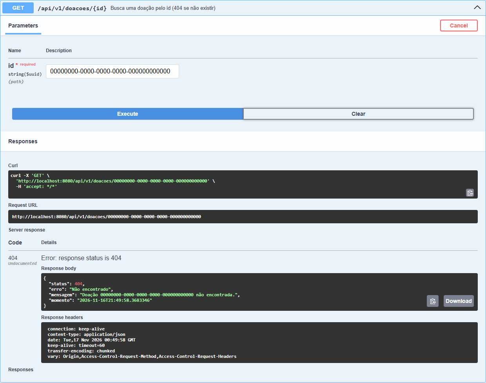
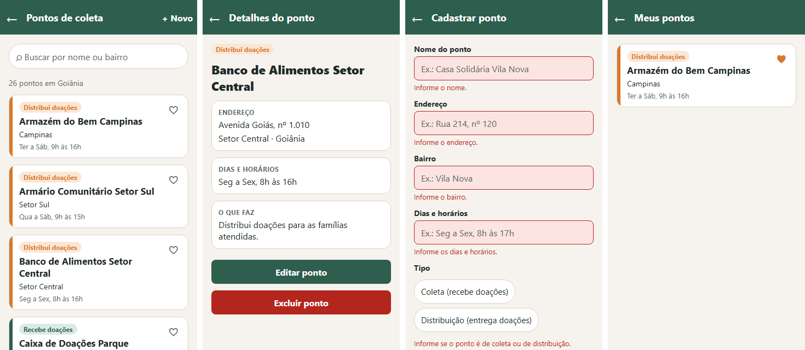
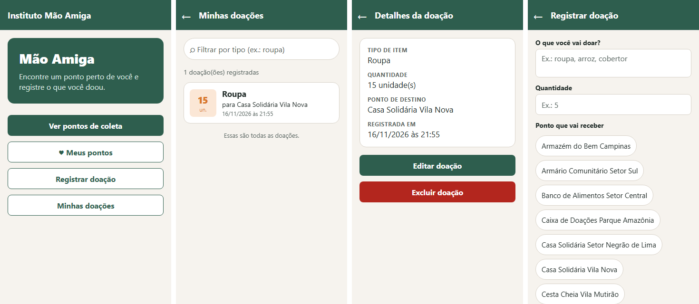
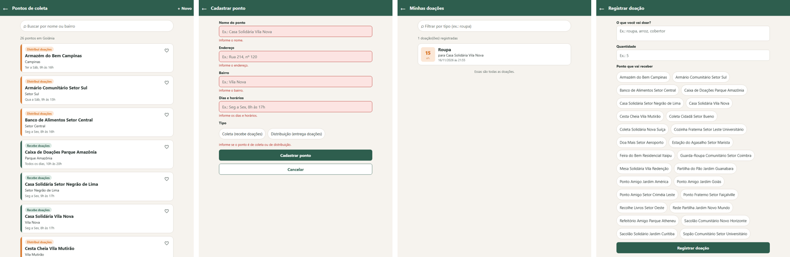

# Instituto Mão Amiga

Aplicativo do **Instituto Mão Amiga**, de Goiânia, com a **API própria em Spring Boot** que ele usa. Pelo app dá para encontrar os pontos de coleta e distribuição de doações, cadastrar, editar e excluir pontos, favoritar os pontos mais usados e registrar as doações feitas, com histórico, filtro, edição e exclusão.

Projeto individual da disciplina de Desenvolvimento de Aplicativos, feito em três etapas: **base**, **N1** (histórico de doações no aparelho) e **N2** (API Spring Boot consumida pelo app).

Autor: **LuuKeeTZ** · Repositório: https://github.com/LuuKeeTZ/instituto-mao-amiga

---

## Sumário

1. [Tecnologias e versões](#tecnologias-e-versões)
2. [Estrutura do repositório](#estrutura-do-repositório)
3. [Como rodar a API](#como-rodar-a-api)
4. [Como rodar o app e onde trocar o IP](#como-rodar-o-app-e-onde-trocar-o-ip)
5. [Funcionalidades por etapa e issues](#funcionalidades-por-etapa-e-issues)
6. [Endpoints da API](#endpoints-da-api)
7. [Decisões técnicas](#decisões-técnicas)
8. [Roteiro de demonstração (até 3 minutos)](#roteiro-de-demonstração-até-3-minutos)
9. [Testes realizados](#testes-realizados)
10. [Limitações conhecidas](#limitações-conhecidas)

---

## Tecnologias e versões

| Parte | Tecnologia | Versão usada |
|---|---|---|
| API | Java (Eclipse Temurin) | **21** (21.0.13) |
| API | Spring Boot (Web MVC, Data JPA, Validation) | 4.1.2 |
| API | Banco H2 gravado em arquivo | 2.4.240 |
| API | springdoc-openapi (Swagger UI) | 3.1.0 |
| API | Lombok | gerenciado pelo Spring Boot |
| API | Maven (via Maven Wrapper, já incluso) | 3.10.1 |
| App | Node.js / npm | 26.13.0 / 12.2.2 |
| App | Expo SDK | 58 (`expo ~58.0.25`) |
| App | React Native / React | 0.88.1 / 19.3.0 |
| App | TypeScript | ~6.0.3 |
| App | React Navigation (native-stack) | 7.x |
| App | AsyncStorage (só para favoritos) | 2.2.0 |
| Testes | Playwright (Chromium), fora do repositório | 1.x |

## Estrutura do repositório

O app fica na raiz e a **API fica na pasta [`api/`](api/)** deste mesmo repositório.

```
.
├── App.tsx                    entrada do app (só monta a navegação)
├── src/
│   ├── services/
│   │   ├── api.ts             ÚNICO arquivo com fetch: URL da API + get/post/put/del
│   │   ├── pontosService.ts   operações de pontos (usa o api.ts)
│   │   └── doacoesService.ts  operações de doações (usa o api.ts)
│   ├── storage/
│   │   └── favoritosStorage.ts  ids dos pontos favoritos no AsyncStorage
│   ├── screens/               uma tela por arquivo
│   ├── components/            cartões, campos, botões, estados de carregando/erro/vazio
│   ├── hooks/                 useListaPaginada (rolagem infinita), useFavoritos, useValorAtrasado
│   ├── navigation/            rotas e parâmetros de cada tela
│   ├── types/                 Ponto, Doacao, Pagina
│   ├── utils/                 validações, datas, mensagens de erro, diálogos
│   └── theme/                 cores, espaçamentos, tamanho mínimo de toque (44)
├── docs/testes/               prints dos testes de layout em 2 tamanhos de tela
└── api/
    ├── pom.xml, mvnw, mvnw.cmd
    ├── docs/swagger/          prints do Swagger (incluindo 400 e 404)
    └── src/main/java/com/institutomaoamiga/api/
        ├── entity/            Ponto, Doacao
        ├── repository/        PontoRepository, DoacaoRepository (@Query)
        ├── service/           PontoService, DoacaoService, RecursoNaoEncontradoException
        ├── controller/        PontoController, DoacaoController
        ├── dto/               PontoRequestDTO, PontoResponseDTO, DoacaoRequestDTO, DoacaoResponseDTO, ErroRespostaDTO
        └── config/            TratadorDeErros, PopularPontosIniciais (carga inicial), DocumentacaoApiConfig
```

## Como rodar a API

Pré-requisito: **Java 21** (`java -version`). Não precisa instalar o Maven, o wrapper baixa sozinho.

```bash
cd api
./mvnw spring-boot:run          # Windows: mvnw.cmd spring-boot:run
```

Ou gerando o `.jar`:

```bash
cd api
./mvnw package                  # Windows: mvnw.cmd package
java -jar target/api-0.0.1-SNAPSHOT.jar
```

- A API sobe em `http://localhost:8080` (e em `http://<IP-do-computador>:8080` para o celular).
- **Swagger UI:** http://localhost:8080/swagger-ui.html
- **Banco H2 em arquivo:** `api/data/maoamiga.mv.db` (fora do Git). Os dados continuam depois de reiniciar a API. Para voltar ao estado inicial, pare a API e apague a pasta `api/data/`.
- **Carga inicial:** 26 pontos de Goiânia, inseridos só quando a tabela está vazia (não duplica ao reiniciar).
- Console do H2: http://localhost:8080/h2-console (JDBC URL `jdbc:h2:file:./data/maoamiga`, usuário `sa`, sem senha).

## Como rodar o app e onde trocar o IP

Pré-requisitos: Node.js e npm. Com a API rodando:

```bash
npm install
npx expo start --web     # no navegador (foi assim que o app foi testado)
npx expo start           # no celular, lendo o QR code com o Expo Go
```

### Onde trocar o IP

O endereço da API fica numa constante só, em **`src/services/api.ts`**:

```ts
export const API_URL = 'http://192.168.15.49:8080/api/v1';
```

1. No computador que roda a API, descubra o IPv4: `ipconfig` no Windows ("Endereço IPv4" do adaptador da rede local) ou `ip addr` no Linux/macOS.
2. Troque `192.168.15.49` por esse IP e salve (o Expo recarrega o app).
3. Celular e computador precisam estar na **mesma rede Wi-Fi**, e o firewall precisa liberar a porta **8080**.
4. Não use `localhost` no celular: lá ele aponta para o próprio celular, não para o computador.

> **Como o app foi testado:** todos os testes do app foram feitos **no navegador** (`npx expo start --web`), automatizados com Playwright, porque não havia celular disponível. O navegador roda no mesmo computador e acessa a API pelo mesmo IP da constante. O teste no celular pela rede local **não foi feito**; os passos acima explicam como fazer.

## Funcionalidades por etapa e issues

### Base
- Lista de pontos e detalhe (endereço, horário, o que faz), navegação em pilha entre as telas.
- Cadastro de doação com validação (tipo, quantidade inteira > 0, ponto de destino).
- Layout auditado: sem tamanhos fixos que quebram, tocáveis ≥ 44x44, formulários com `KeyboardAvoidingView`.

### N1 — histórico de doações no aparelho
- Histórico em array no AsyncStorage, com todo o acesso num arquivo só (`doacoesStorage.ts`).
- Tela "Minhas doações" com `FlatList` e item em `React.memo`; detalhe com exclusão confirmada; edição pelo mesmo formulário; filtro por tipo enquanto digita; resumo com totais por tipo.
- Na N2 esse armazenamento local foi substituído pela API (o roteiro da N1 está no README da entrega da N1, commit [`cf37ee5`](https://github.com/LuuKeeTZ/instituto-mao-amiga/blob/cf37ee5/README.md)).

### N2 — API própria
- API Spring Boot com CRUD de pontos e de doações, validação (400), 404, busca paginada e Swagger.
- App consumindo a API em camadas (`api.ts` → services → telas), com rolagem infinita, busca pela API, CRUD de pontos e de doações, estados de carregando/erro/vazio e mensagens claras com a API desligada.
- Favoritos guardados no aparelho (só os ids) e tela "Meus pontos" buscando os dados na API.

### As 18 issues

| # | Issue | Etapa |
|---|---|---|
| [#1](https://github.com/LuuKeeTZ/instituto-mao-amiga/issues/1) | Issue #03 — Lista e detalhe dos pontos | Base |
| [#2](https://github.com/LuuKeeTZ/instituto-mao-amiga/issues/2) | Issue #04 — Navegação entre lista e detalhe | Base |
| [#3](https://github.com/LuuKeeTZ/instituto-mao-amiga/issues/3) | Issue #06 — Layout responsivo do app individual | Base |
| [#4](https://github.com/LuuKeeTZ/instituto-mao-amiga/issues/4) | Issue #08 — Histórico de doações salvo no aparelho | N1 |
| [#5](https://github.com/LuuKeeTZ/instituto-mao-amiga/issues/5) | Issue #09 — Tela de histórico com FlatList | N1 |
| [#6](https://github.com/LuuKeeTZ/instituto-mao-amiga/issues/6) | Issue #10 — Detalhe da doação e exclusão | N1 |
| [#7](https://github.com/LuuKeeTZ/instituto-mao-amiga/issues/7) | Issue #11 — Editar uma doação | N1 |
| [#8](https://github.com/LuuKeeTZ/instituto-mao-amiga/issues/8) | Issue #12 — Filtro por tipo de item | N1 |
| [#9](https://github.com/LuuKeeTZ/instituto-mao-amiga/issues/9) | Issue #13 — Resumo com totais por tipo | N1 |
| [#10](https://github.com/LuuKeeTZ/instituto-mao-amiga/issues/10) | Issue #14 — Acabamento e roteiro de demonstração | N1 |
| [#11](https://github.com/LuuKeeTZ/instituto-mao-amiga/issues/11) | [N2-1] CRUD de pontos de coleta na API | N2 |
| [#12](https://github.com/LuuKeeTZ/instituto-mao-amiga/issues/12) | [N2-2] Busca de pontos com paginação | N2 |
| [#13](https://github.com/LuuKeeTZ/instituto-mao-amiga/issues/13) | [N2-3] App listando os pontos da API | N2 |
| [#14](https://github.com/LuuKeeTZ/instituto-mao-amiga/issues/14) | [N2-4] App: cadastrar, editar e excluir pontos | N2 |
| [#15](https://github.com/LuuKeeTZ/instituto-mao-amiga/issues/15) | [N2-5] CRUD de doações na API | N2 |
| [#16](https://github.com/LuuKeeTZ/instituto-mao-amiga/issues/16) | [N2-6] Histórico e cadastro de doações pela API | N2 |
| [#17](https://github.com/LuuKeeTZ/instituto-mao-amiga/issues/17) | [N2-7] Editar e excluir doação pela API | N2 |
| [#18](https://github.com/LuuKeeTZ/instituto-mao-amiga/issues/18) | [N2-8] Pontos favoritos e roteiro de demonstração | N2 |

Cada issue tem um comentário com o que foi feito, os testes executados e os commits.

## Endpoints da API

Todas as respostas usam DTOs (`record`); a entidade nunca sai do service. Erros seguem o formato:

```json
{
  "status": 400,
  "erro": "Dados inválidos",
  "mensagem": "Corrija os campos indicados e envie de novo.",
  "campos": { "nome": "O nome é obrigatório.", "bairro": "O bairro é obrigatório." },
  "momento": "2026-11-16T21:35:52.6023966"
}
```

### Pontos de coleta

| Método | URL | Respostas |
|---|---|---|
| GET | `http://localhost:8080/api/v1/pontos` | 200 |
| GET | `http://localhost:8080/api/v1/pontos/filtro?filtro=&page=0&size=10` | 200 (paginado) |
| GET | `http://localhost:8080/api/v1/pontos/{id}` | 200, 404 |
| POST | `http://localhost:8080/api/v1/pontos` | 201, 400 |
| PUT | `http://localhost:8080/api/v1/pontos/{id}` | 200, 400, 404 |
| DELETE | `http://localhost:8080/api/v1/pontos/{id}` | 204, 404 |

Corpo do POST/PUT (todos os campos obrigatórios; `tipo` é `coleta` ou `distribuição`):

```json
{
  "nome": "Bazar Solidário Setor Sul",
  "endereco": "Rua 83, nº 450",
  "bairro": "Setor Sul",
  "horario": "Sáb, 8h às 14h",
  "tipo": "coleta"
}
```

Prints do Swagger (gerados com Playwright executando cada endpoint):

| Chamada | Print |
|---|---|
| GET lista → 200 | [pontos-01-listar-200.png](api/docs/swagger/pontos-01-listar-200.png) |
| GET por id → 200 | [pontos-02-buscar-por-id-200.png](api/docs/swagger/pontos-02-buscar-por-id-200.png) |
| POST → 201 | [pontos-03-cadastrar-201.png](api/docs/swagger/pontos-03-cadastrar-201.png) |
| PUT → 200 | [pontos-04-editar-200.png](api/docs/swagger/pontos-04-editar-200.png) |
| DELETE → 204 | [pontos-05-excluir-204.png](api/docs/swagger/pontos-05-excluir-204.png) |
| POST com nome e bairro vazios → **400** | [pontos-06-cadastrar-vazio-400.png](api/docs/swagger/pontos-06-cadastrar-vazio-400.png) |
| GET id inexistente → **404** | [pontos-07-buscar-inexistente-404.png](api/docs/swagger/pontos-07-buscar-inexistente-404.png) |
| PUT id inexistente → **404** | [pontos-08-editar-inexistente-404.png](api/docs/swagger/pontos-08-editar-inexistente-404.png) |


### Busca paginada de pontos

`GET http://localhost:8080/api/v1/pontos/filtro?filtro=...&page=0&size=10`

- `filtro` (opcional): procura no **nome ou no bairro**, sem diferenciar maiúsculas (`@Query` no `PontoRepository`). Sem `filtro`, devolve todos.
- Padrão: 10 itens por página, em ordem de nome (`@PageableDefault(size = 10, sort = "nome")`). `sort=bairro,asc` troca a ordem.
- Resposta no formato `content` + `page` (`spring.data.web.pageable.serialization-mode=via_dto`).
- A carga inicial tem 26 pontos.

Exemplos reais (com `size=3` para caber aqui):

**1. Sem filtro (primeira página)**

```http
GET /api/v1/pontos/filtro?page=0&size=3
```

```json
{
  "content": [
    {
      "id": "ba386881-c4a5-42ee-8b95-ae0b7a27d557",
      "nome": "Armazém do Bem Campinas",
      "endereco": "Rua Senador Jaime, nº 455",
      "bairro": "Campinas",
      "horario": "Ter a Sáb, 9h às 16h",
      "tipo": "distribuição"
    },
    {
      "id": "83b4e537-95d4-487c-874b-e81409294d6f",
      "nome": "Armário Comunitário Setor Sul",
      "endereco": "Rua 90, nº 520",
      "bairro": "Setor Sul",
      "horario": "Qua a Sáb, 9h às 15h",
      "tipo": "distribuição"
    },
    {
      "id": "a2c7c320-0a9a-4070-a7ce-f9f508f1f1e6",
      "nome": "Banco de Alimentos Setor Central",
      "endereco": "Avenida Goiás, nº 1.010",
      "bairro": "Setor Central",
      "horario": "Seg a Sex, 8h às 16h",
      "tipo": "distribuição"
    }
  ],
  "page": {
    "size": 3,
    "number": 0,
    "totalElements": 26,
    "totalPages": 9
  }
}
```

**2. Filtrando por bairro ("jardim")**

```http
GET /api/v1/pontos/filtro?filtro=jardim&page=0&size=3
```

```json
{
  "content": [
    {
      "id": "834267a0-faba-48d3-b1bf-de3910d72973",
      "nome": "Partilha do Pão Jardim Guanabara",
      "endereco": "Rua JG-12, nº 300",
      "bairro": "Jardim Guanabara",
      "horario": "Ter a Sex, 7h às 9h",
      "tipo": "distribuição"
    },
    {
      "id": "34c9c7f9-10e5-4d2c-9a0f-1b71db6627c7",
      "nome": "Ponto Amigo Jardim América",
      "endereco": "Rua C-140, nº 300",
      "bairro": "Jardim América",
      "horario": "Seg, Qua e Sex, 13h às 18h",
      "tipo": "coleta"
    },
    {
      "id": "cb73c9a6-a50c-4c53-992b-2c8c2b82a9e9",
      "nome": "Ponto Amigo Jardim Goiás",
      "endereco": "Rua 55, nº 230",
      "bairro": "Jardim Goiás",
      "horario": "Ter e Qui, 10h às 17h",
      "tipo": "coleta"
    }
  ],
  "page": {
    "size": 3,
    "number": 0,
    "totalElements": 5,
    "totalPages": 2
  }
}
```

**3. Segunda página**

```http
GET /api/v1/pontos/filtro?page=1&size=3
```

```json
{
  "content": [
    {
      "id": "c30cbac9-3ebc-4499-a73c-0df0ef10138e",
      "nome": "Caixa de Doações Parque Amazônia",
      "endereco": "Avenida Rio Verde, nº 2.300",
      "bairro": "Parque Amazônia",
      "horario": "Todos os dias, 10h às 20h",
      "tipo": "coleta"
    },
    {
      "id": "a8f1f955-24c0-4a2c-8188-4f9534cbc043",
      "nome": "Casa Solidária Setor Negrão de Lima",
      "endereco": "Rua Benjamin Constant, nº 270",
      "bairro": "Setor Negrão de Lima",
      "horario": "Seg a Sex, 9h às 17h",
      "tipo": "coleta"
    },
    {
      "id": "878fb7ca-fdad-443d-9144-c96ae9b621a8",
      "nome": "Casa Solidária Vila Nova",
      "endereco": "Rua 214, nº 120",
      "bairro": "Vila Nova",
      "horario": "Seg a Sex, 8h às 17h",
      "tipo": "coleta"
    }
  ],
  "page": {
    "size": 3,
    "number": 1,
    "totalElements": 26,
    "totalPages": 9
  }
}
```

Print do Swagger da busca: [pontos-09-filtro-paginado-200.png](api/docs/swagger/pontos-09-filtro-paginado-200.png)

### Doações

| Método | URL | Respostas |
|---|---|---|
| GET | `http://localhost:8080/api/v1/doacoes/filtro?filtro=&page=0&size=10` | 200 (paginado, mais nova primeiro) |
| GET | `http://localhost:8080/api/v1/doacoes/{id}` | 200, 404 |
| POST | `http://localhost:8080/api/v1/doacoes` | 201, 400 |
| PUT | `http://localhost:8080/api/v1/doacoes/{id}` | 200, 400, 404 |
| DELETE | `http://localhost:8080/api/v1/doacoes/{id}` | 204, 404 |

- `filtro` procura no **tipo de item**, sem diferenciar maiúsculas; a ordem padrão é `criadoEm` decrescente (`@PageableDefault(sort = "criadoEm", direction = Sort.Direction.DESC)`).
- `criadoEm` é preenchido pela API (`LocalDateTime.now()` no service) no cadastro; o app não envia e a edição não muda.
- `tipoItem` e `pontoDestino` obrigatórios; `quantidade` obrigatória e maior que zero.

Corpo do POST/PUT e resposta:

```json
// envio
{ "tipoItem": "Feijão", "quantidade": 10, "pontoDestino": "Coleta Cidadã Setor Bueno" }

// resposta 201
{
  "id": "6d8d94f4-e260-4457-966e-23233807296a",
  "tipoItem": "Feijão",
  "quantidade": 10,
  "pontoDestino": "Coleta Cidadã Setor Bueno",
  "criadoEm": "2026-11-16T21:49:47.512"
}
```

| Chamada | Print |
|---|---|
| GET filtro "roupa" → 200 | [doacoes-01-filtro-200.png](api/docs/swagger/doacoes-01-filtro-200.png) |
| GET por id → 200 | [doacoes-02-buscar-por-id-200.png](api/docs/swagger/doacoes-02-buscar-por-id-200.png) |
| POST → 201 | [doacoes-03-cadastrar-201.png](api/docs/swagger/doacoes-03-cadastrar-201.png) |
| PUT → 200 | [doacoes-04-editar-200.png](api/docs/swagger/doacoes-04-editar-200.png) |
| DELETE → 204 | [doacoes-05-excluir-204.png](api/docs/swagger/doacoes-05-excluir-204.png) |
| POST com quantidade 0 → **400** | [doacoes-06-quantidade-zero-400.png](api/docs/swagger/doacoes-06-quantidade-zero-400.png) |
| POST com tipo vazio e quantidade negativa → **400** | [doacoes-07-tipo-vazio-400.png](api/docs/swagger/doacoes-07-tipo-vazio-400.png) |
| GET id inexistente → **404** | [doacoes-08-buscar-inexistente-404.png](api/docs/swagger/doacoes-08-buscar-inexistente-404.png) |
| PUT id inexistente → **404** | [doacoes-09-editar-inexistente-404.png](api/docs/swagger/doacoes-09-editar-inexistente-404.png) |




## Decisões técnicas

### Favoritos no aparelho × pontos e doações no servidor

- **Pontos e doações são dados do Instituto**: todos os voluntários precisam ver a mesma lista, um ponto editado tem que aparecer editado para todo mundo, e uma doação registrada não pode sumir se o celular for trocado. Por isso ficam na API, num banco só, com validação no servidor (400 quando o dado é inválido, 404 quando não existe).
- **Favorito é uma preferência de quem está usando o celular**: não interessa a mais ninguém, não precisa de login e funciona mesmo sem a API para lembrar o que foi marcado. Por isso fica no AsyncStorage do aparelho.
- **Só os ids ficam guardados**: os dados do ponto (nome, endereço, horário) sempre vêm da API na tela "Meus pontos". Se alguém edita o ponto, o favorito já mostra o valor novo; se o ponto foi excluído, a API responde 404, ele fica de fora da tela e o id sai da lista salva, sem quebrar nada.

### Acesso à rede só pelo `api.ts`

- `src/services/api.ts` é o único arquivo com `fetch`. Ele tem a URL num lugar só, as funções `get`, `post`, `put` e `del`, um tempo limite de 10 s e transforma qualquer resposta de erro numa exceção `ApiErro` com o **status** HTTP (status 0 quando não conseguiu conectar).
- As telas chamam `pontosService` e `doacoesService` e nunca montam URL. Assim: trocar o IP é mudar uma linha; tratar erro é igual em todo o app (`mensagemDeErro`); e o 404 vira "ponto não encontrado"/"doação não encontrada" de forma consistente.

### Totais calculados, não salvos (N1)

- Na N1 o resumo por tipo era calculado a cada renderização a partir do array de doações, e não salvo à parte: um dado derivado salvo pode ficar desatualizado depois de registrar, editar ou excluir. Na N2, com o histórico paginado pela API, o resumo saiu da tela, como o enunciado permite.

### Outras decisões

- **Um formulário para cadastrar e editar** (pontos e doações): sem parâmetro é cadastro; com `{ id }` é edição, preenchida pela API e com o botão "Salvar alterações". As validações são as mesmas nos dois casos.
- **Navegação só com o `id`**: os detalhes buscam o dado na API pelo id, então sempre mostram a versão atual e tratam o 404.
- **Rolagem infinita num hook** (`useListaPaginada`): guarda as páginas já pedidas para nunca pedir a mesma duas vezes, para na última página (`totalPages`) e descarta respostas atrasadas quando a busca muda. É usado na lista de pontos e no histórico.
- **Erro não finge sucesso**: em 400 ou com a API desligada, o formulário mostra a mensagem (com os campos que a API recusou), mantém o que foi digitado e não volta de tela.
- **Diálogos no navegador**: o `Alert.alert` do react-native-web não abre nada, então `src/utils/dialogos.ts` usa `Alert.alert` (Cancelar/Excluir) no celular e `window.confirm` no navegador.
- **`criadoEm` definido pela API**: o app não envia a data; o service usa `LocalDateTime.now()` no cadastro e a coluna não aceita UPDATE.

## Roteiro de demonstração (até 3 minutos)

Antes: API rodando (`cd api && ./mvnw spring-boot:run`), app aberto (`npx expo start --web` ou Expo Go) e Swagger aberto em outra aba.

| Tempo | Passo | O que mostrar |
|---|---|---|
| 0:00 | **Buscar** | "Ver pontos de coleta" → digitar `jardim` → 5 pontos (nome ou bairro, direto na API). Rolar a lista sem filtro: a próxima página carrega sozinha. |
| 0:25 | **Cadastrar ponto** | "+ Novo" → Bazar Solidário Setor Sul / Rua 83, nº 450 / Setor Sul / Sáb, 8h às 14h / Coleta → "Cadastrar ponto". Aparece na lista. |
| 0:45 | **Editar ponto** | Tocar no ponto → "Editar ponto" (mesmo formulário, preenchido) → horário "Sáb e Dom, 8h às 14h" → "Salvar alterações". O detalhe mostra o valor novo. |
| 1:00 | **Excluir ponto** | "Excluir ponto" → confirmar → some da lista. |
| 1:10 | **Favoritar** | Tocar no ♡ de "Armazém do Bem Campinas" → ♥. Início → "♥ Meus pontos": ele aparece, buscado na API pelo id. Recarregar o app: continua favorito. |
| 1:35 | **Cadastrar doação** | "Registrar doação" → Roupa / 12 / escolher "Casa Solidária Vila Nova" → registrar. "Minhas doações": ela está no topo. |
| 1:55 | **Editar doação** | Tocar na doação → "Editar doação" → 15 → "Salvar alterações". Mesmo id e mesma data de registro. |
| 2:10 | **Excluir doação** | "Excluir doação" → confirmar → volta ao histórico sem ela. |
| 2:20 | **400 e 404 na API** | No Swagger: `POST /api/v1/doacoes` com `"quantidade": 0` → **400** com a mensagem do campo; `GET /api/v1/pontos/00000000-0000-0000-0000-000000000000` → **404**. |
| 2:40 | **Decisão técnica** | Explicar por que favoritos ficam no aparelho e pontos/doações no servidor (seção acima). |

Esse roteiro foi executado de ponta a ponta por um script Playwright contra a API real (9 passos aprovados).

## Testes realizados

Status usados: **Testado e aprovado** · **Não testado** (o que não foi possível testar aqui).

Os testes do app foram feitos no navegador (expo web, 390x844 e mais os tamanhos abaixo) com scripts Playwright, contra a API real rodando localmente. Os testes da API usam chamadas HTTP de verdade (`fetch`). Os detalhes e as saídas de cada teste estão nos comentários de cada issue.

### API

| Teste | Status |
|---|---|
| CRUD de pontos (GET lista, GET id, POST 201, PUT 200, DELETE 204) | Testado e aprovado |
| CRUD de doações (GET filtro, GET id, POST 201, PUT 200, DELETE 204) | Testado e aprovado |
| 400: cada campo de ponto vazio, tipo inválido, quantidade 0/negativa, tipo de item vazio — e nada é gravado | Testado e aprovado |
| 404: GET, PUT e DELETE de id inexistente (pontos e doações) | Testado e aprovado |
| Busca paginada de pontos: 10 por página, ordem por nome, `sort=bairro,asc`, filtro por nome ou bairro sem diferenciar maiúsculas, última página | Testado e aprovado |
| Filtro de doações por tipo, da mais nova para a mais antiga | Testado e aprovado |
| `criadoEm` definido pela API e mantido na edição | Testado e aprovado |
| Persistência depois de reiniciar a API (H2 em arquivo) e carga inicial sem duplicar | Testado e aprovado |
| CORS liberado (`Access-Control-Allow-Origin: *`) | Testado e aprovado |
| Prints do Swagger de cada endpoint, com 400 e 404 | Testado e aprovado |

### App

| Teste | Status |
|---|---|
| Lista de pontos da API com indicador de carregamento na primeira página | Testado e aprovado |
| Rolagem infinita: páginas 0, 1, 2 pedidas uma vez cada e parada na última | Testado e aprovado |
| Busca pela API voltando à página 0 a cada busca | Testado e aprovado |
| Detalhe pelo id e "Ponto não encontrado." no 404 | Testado e aprovado |
| CRUD de pontos (POST, PUT com "Salvar alterações", DELETE com confirmação) | Testado e aprovado |
| 400 real da API no formulário (mensagem do campo, dados mantidos) | Testado e aprovado |
| Doações: cadastro (destino escolhido entre os pontos da API, envia o nome), histórico com rolagem infinita, filtro pela API, nova no topo | Testado e aprovado |
| Doações: detalhe pelo id, "Doação não encontrada.", edição mantendo id e data, exclusão | Testado e aprovado |
| Favoritos: ♡/♥ com 44x44, só ids no AsyncStorage, mantidos ao fechar e reabrir o navegador, "Meus pontos", ponto excluído fora, desmarcar na hora | Testado e aprovado |
| API desligada (processo parado de verdade): lista, histórico, cadastro e exclusão mostram mensagem e não fingem sucesso | Testado e aprovado |
| Estados de carregando, erro e vazio | Testado e aprovado |
| `npx tsc --noEmit` sem erros | Testado e aprovado |
| Layout em 2 tamanhos (360x640 e 768x1024): nada cortado/sobreposto/fora da tela, todo tocável ≥ 44x44 | Testado e aprovado |
| Teclado: simulado no navegador reduzindo a janela para 360 px de altura e focando cada campo | Testado e aprovado (simulação) |
| App no celular pela rede local (Expo Go + IP do computador) | **Não testado** (sem celular disponível) |
| `Alert.alert` nativo (Cancelar/Excluir) no celular | **Não testado** (no navegador foi testado o `confirm` equivalente) |

### Prints do layout

Script que mede todos os tocáveis (mínimo 44x44), procura rolagem horizontal, elementos fora da tela e textos cortados, e simula o teclado aberto.

| Telas | Print |
|---|---|
| N2 — pontos (lista com ♡, detalhe, formulário com validação, Meus pontos) em 360x640 |  |
| N2 — início, histórico, detalhe e cadastro de doação em 360x640 |  |
| N2 — lista, formulário de ponto, histórico e cadastro de doação em 768x1024 |  |
| Base (Issue #06) em 360x640 e 768x1024 | [360x640](docs/testes/issue06-360x640.png) · [768x1024](docs/testes/issue06-768x1024.png) |
| N1 (Issue #14) em 360x640 e 768x1024 | [360x640](docs/testes/issue14-360x640.png) · [768x1024](docs/testes/issue14-768x1024.png) |

## Limitações conhecidas

- O app **não foi testado num celular**: todos os testes foram no navegador. O endereço da API está fixo em `src/services/api.ts` e precisa ser trocado pelo IP da máquina que roda a API.
- O teclado virtual não existe no navegador; a proteção (`KeyboardAvoidingView` + rolagem) foi verificada por simulação, reduzindo a altura da janela.
- No navegador, as confirmações usam `window.confirm`/`window.alert`; o `Alert.alert` nativo só aparece no celular.
- A ordem por nome segue o `ORDER BY` do H2, que compara pelo código dos caracteres: nomes com acento podem vir depois do esperado (ex.: "Armazém" antes de "Armário").
- A doação guarda o **nome** do ponto de destino (como pede o enunciado), não o id: se o ponto for renomeado ou excluído depois, a doação continua com o nome antigo.
- Não há login: qualquer pessoa com acesso à API pode cadastrar, editar e excluir (fora do escopo do enunciado).
- O banco H2 em arquivo serve para desenvolvimento e demonstração, não para produção.
