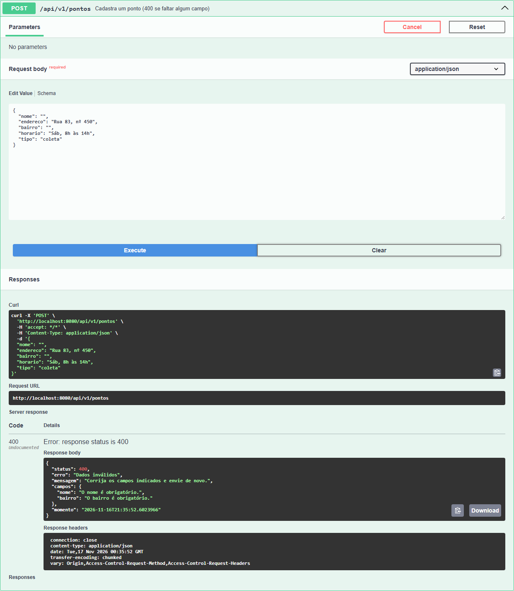
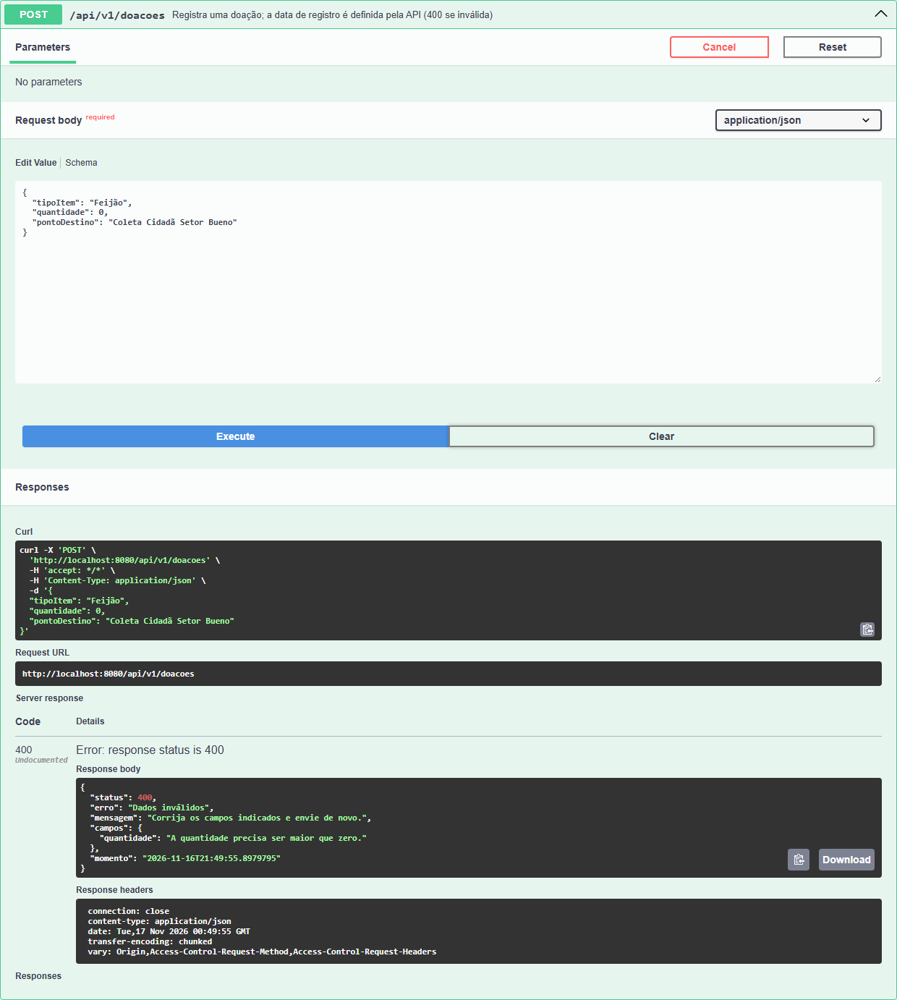
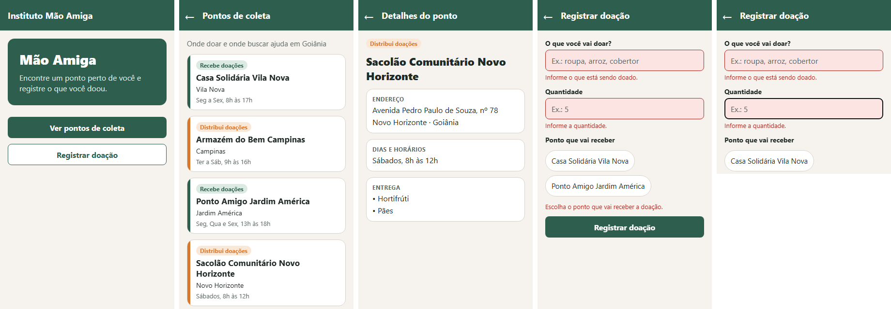
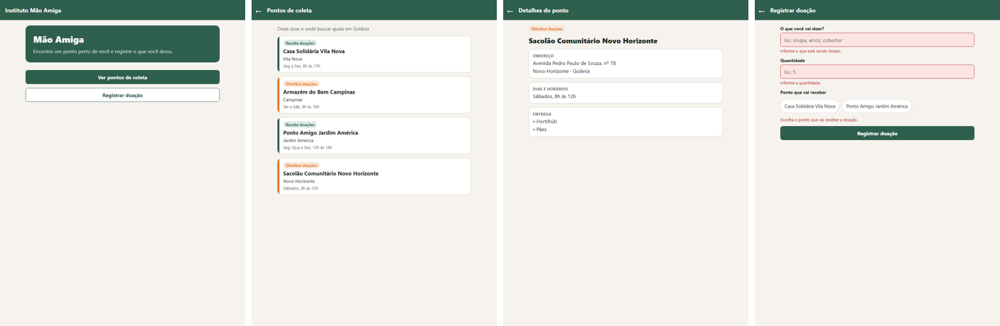

# Instituto Mão Amiga

Aplicativo do Instituto Mão Amiga, em Goiânia: mostra os pontos de coleta e distribuição de doações e guarda o histórico das doações registradas.

Autor: **LuuKeeTZ** — projeto individual da disciplina de Desenvolvimento de Aplicativos.

## Tecnologias

- React Native + Expo (SDK 58) com TypeScript
- React Navigation (native-stack)
- AsyncStorage (dados salvos no aparelho)

## Como rodar

```bash
npm install
npx expo start          # Expo Go no celular (QR code)
npx expo start --web    # no navegador
```

### Endereço da API (onde trocar o IP)

O app só fala com a API por `src/services/api.ts`, e o endereço fica numa constante só:

```ts
export const API_URL = 'http://192.168.15.49:8080/api/v1';
```

- **No celular (Expo Go)**: troque `192.168.15.49` pelo IPv4 do computador que roda a API (`ipconfig` no Windows, "Endereço IPv4"). Celular e computador precisam estar na mesma rede Wi-Fi, e o firewall do Windows precisa liberar a porta 8080. Não use `localhost`: no celular ele aponta para o próprio celular.
- **No navegador** (`npx expo start --web`) o mesmo IP funciona, porque o navegador roda no próprio computador.

> **Como o app foi testado:** todos os testes do app foram feitos **no navegador** (expo web), com Playwright, porque não havia celular disponível. O teste no celular pela rede local **não foi feito**; os passos acima explicam como fazer.

## Estrutura

```
App.tsx                 ponto de entrada (só monta a navegação)
src/
  navigation/           rotas e parâmetros de cada tela
  screens/              uma tela por arquivo
  components/           peças reaproveitadas (cartões, campos, botões, estados)
  storage/              acesso ao AsyncStorage (doacoesStorage.ts)
  utils/                validação, datas, totais e diálogos
  types/                tipos Ponto e Doacao
  theme/                cores, espaçamentos e tamanho mínimo de toque
docs/testes/            prints dos testes de layout
```

## API (pasta `api/`)

A API em Spring Boot fica na pasta [`api/`](api/) deste mesmo repositório.

```bash
cd api
./mvnw spring-boot:run        # Windows: mvnw.cmd spring-boot:run
```

- Java 21 (Maven Wrapper incluso, não precisa instalar o Maven)
- Banco H2 gravado em arquivo: `api/data/maoamiga.mv.db` (fora do Git). Apagar a pasta `api/data/` recria o banco com a carga inicial.
- Swagger UI: http://localhost:8080/swagger-ui.html
- Console do H2: http://localhost:8080/h2-console (JDBC URL `jdbc:h2:file:./data/maoamiga`, usuário `sa`, sem senha)

### Pontos de coleta

| Método | URL | Respostas |
|---|---|---|
| GET | `http://localhost:8080/api/v1/pontos` | 200 |
| GET | `http://localhost:8080/api/v1/pontos/filtro?filtro=&page=0&size=10` | 200 (paginado) |
| GET | `http://localhost:8080/api/v1/pontos/{id}` | 200, 404 |
| POST | `http://localhost:8080/api/v1/pontos` | 201, 400 |
| PUT | `http://localhost:8080/api/v1/pontos/{id}` | 200, 400, 404 |
| DELETE | `http://localhost:8080/api/v1/pontos/{id}` | 204, 404 |

Corpo do POST/PUT (todos os campos obrigatórios; `tipo` é `coleta` ou `distribuição`):

```json
{
  "nome": "Bazar Solidário Setor Sul",
  "endereco": "Rua 83, nº 450",
  "bairro": "Setor Sul",
  "horario": "Sáb, 8h às 14h",
  "tipo": "coleta"
}
```

Prints do Swagger (gerados com Playwright executando cada endpoint):

| Chamada | Print |
|---|---|
| GET lista → 200 | [pontos-01-listar-200.png](api/docs/swagger/pontos-01-listar-200.png) |
| GET por id → 200 | [pontos-02-buscar-por-id-200.png](api/docs/swagger/pontos-02-buscar-por-id-200.png) |
| POST → 201 | [pontos-03-cadastrar-201.png](api/docs/swagger/pontos-03-cadastrar-201.png) |
| PUT → 200 | [pontos-04-editar-200.png](api/docs/swagger/pontos-04-editar-200.png) |
| DELETE → 204 | [pontos-05-excluir-204.png](api/docs/swagger/pontos-05-excluir-204.png) |
| POST com nome e bairro vazios → **400** | [pontos-06-cadastrar-vazio-400.png](api/docs/swagger/pontos-06-cadastrar-vazio-400.png) |
| GET id inexistente → **404** | [pontos-07-buscar-inexistente-404.png](api/docs/swagger/pontos-07-buscar-inexistente-404.png) |
| PUT id inexistente → **404** | [pontos-08-editar-inexistente-404.png](api/docs/swagger/pontos-08-editar-inexistente-404.png) |




### Busca paginada de pontos

`GET http://localhost:8080/api/v1/pontos/filtro?filtro=...&page=0&size=10`

- `filtro` (opcional): procura no **nome ou no bairro**, sem diferenciar maiúsculas (`@Query` no `PontoRepository`). Sem `filtro`, devolve todos.
- Padrão: 10 itens por página, em ordem de nome (`@PageableDefault(size = 10, sort = "nome")`). `sort=bairro,asc` troca a ordem.
- Resposta no formato `content` + `page` (`spring.data.web.pageable.serialization-mode=via_dto`).
- A carga inicial tem 26 pontos.

Exemplos reais (com `size=3` para caber aqui):

**1. Sem filtro (primeira página)**

```http
GET /api/v1/pontos/filtro?page=0&size=3
```

```json
{
  "content": [
    {
      "id": "ba386881-c4a5-42ee-8b95-ae0b7a27d557",
      "nome": "Armazém do Bem Campinas",
      "endereco": "Rua Senador Jaime, nº 455",
      "bairro": "Campinas",
      "horario": "Ter a Sáb, 9h às 16h",
      "tipo": "distribuição"
    },
    {
      "id": "83b4e537-95d4-487c-874b-e81409294d6f",
      "nome": "Armário Comunitário Setor Sul",
      "endereco": "Rua 90, nº 520",
      "bairro": "Setor Sul",
      "horario": "Qua a Sáb, 9h às 15h",
      "tipo": "distribuição"
    },
    {
      "id": "a2c7c320-0a9a-4070-a7ce-f9f508f1f1e6",
      "nome": "Banco de Alimentos Setor Central",
      "endereco": "Avenida Goiás, nº 1.010",
      "bairro": "Setor Central",
      "horario": "Seg a Sex, 8h às 16h",
      "tipo": "distribuição"
    }
  ],
  "page": {
    "size": 3,
    "number": 0,
    "totalElements": 26,
    "totalPages": 9
  }
}
```

**2. Filtrando por bairro ("jardim")**

```http
GET /api/v1/pontos/filtro?filtro=jardim&page=0&size=3
```

```json
{
  "content": [
    {
      "id": "834267a0-faba-48d3-b1bf-de3910d72973",
      "nome": "Partilha do Pão Jardim Guanabara",
      "endereco": "Rua JG-12, nº 300",
      "bairro": "Jardim Guanabara",
      "horario": "Ter a Sex, 7h às 9h",
      "tipo": "distribuição"
    },
    {
      "id": "34c9c7f9-10e5-4d2c-9a0f-1b71db6627c7",
      "nome": "Ponto Amigo Jardim América",
      "endereco": "Rua C-140, nº 300",
      "bairro": "Jardim América",
      "horario": "Seg, Qua e Sex, 13h às 18h",
      "tipo": "coleta"
    },
    {
      "id": "cb73c9a6-a50c-4c53-992b-2c8c2b82a9e9",
      "nome": "Ponto Amigo Jardim Goiás",
      "endereco": "Rua 55, nº 230",
      "bairro": "Jardim Goiás",
      "horario": "Ter e Qui, 10h às 17h",
      "tipo": "coleta"
    }
  ],
  "page": {
    "size": 3,
    "number": 0,
    "totalElements": 5,
    "totalPages": 2
  }
}
```

**3. Segunda página**

```http
GET /api/v1/pontos/filtro?page=1&size=3
```

```json
{
  "content": [
    {
      "id": "c30cbac9-3ebc-4499-a73c-0df0ef10138e",
      "nome": "Caixa de Doações Parque Amazônia",
      "endereco": "Avenida Rio Verde, nº 2.300",
      "bairro": "Parque Amazônia",
      "horario": "Todos os dias, 10h às 20h",
      "tipo": "coleta"
    },
    {
      "id": "a8f1f955-24c0-4a2c-8188-4f9534cbc043",
      "nome": "Casa Solidária Setor Negrão de Lima",
      "endereco": "Rua Benjamin Constant, nº 270",
      "bairro": "Setor Negrão de Lima",
      "horario": "Seg a Sex, 9h às 17h",
      "tipo": "coleta"
    },
    {
      "id": "878fb7ca-fdad-443d-9144-c96ae9b621a8",
      "nome": "Casa Solidária Vila Nova",
      "endereco": "Rua 214, nº 120",
      "bairro": "Vila Nova",
      "horario": "Seg a Sex, 8h às 17h",
      "tipo": "coleta"
    }
  ],
  "page": {
    "size": 3,
    "number": 1,
    "totalElements": 26,
    "totalPages": 9
  }
}
```

Print do Swagger da busca: [pontos-09-filtro-paginado-200.png](api/docs/swagger/pontos-09-filtro-paginado-200.png)

### Doações

| Método | URL | Respostas |
|---|---|---|
| GET | `http://localhost:8080/api/v1/doacoes/filtro?filtro=&page=0&size=10` | 200 (paginado, mais nova primeiro) |
| GET | `http://localhost:8080/api/v1/doacoes/{id}` | 200, 404 |
| POST | `http://localhost:8080/api/v1/doacoes` | 201, 400 |
| PUT | `http://localhost:8080/api/v1/doacoes/{id}` | 200, 400, 404 |
| DELETE | `http://localhost:8080/api/v1/doacoes/{id}` | 204, 404 |

- `filtro` procura no **tipo de item**, sem diferenciar maiúsculas; a ordem padrão é `criadoEm` decrescente (`@PageableDefault(sort = "criadoEm", direction = Sort.Direction.DESC)`).
- `criadoEm` é preenchido pela API (`LocalDateTime.now()` no service) no cadastro; o app não envia e a edição não muda.
- `tipoItem` e `pontoDestino` obrigatórios; `quantidade` obrigatória e maior que zero.

Corpo do POST/PUT e resposta:

```json
// envio
{ "tipoItem": "Feijão", "quantidade": 10, "pontoDestino": "Coleta Cidadã Setor Bueno" }

// resposta 201
{
  "id": "6d8d94f4-e260-4457-966e-23233807296a",
  "tipoItem": "Feijão",
  "quantidade": 10,
  "pontoDestino": "Coleta Cidadã Setor Bueno",
  "criadoEm": "2026-11-16T21:49:47.512"
}
```

| Chamada | Print |
|---|---|
| GET filtro "roupa" → 200 | [doacoes-01-filtro-200.png](api/docs/swagger/doacoes-01-filtro-200.png) |
| GET por id → 200 | [doacoes-02-buscar-por-id-200.png](api/docs/swagger/doacoes-02-buscar-por-id-200.png) |
| POST → 201 | [doacoes-03-cadastrar-201.png](api/docs/swagger/doacoes-03-cadastrar-201.png) |
| PUT → 200 | [doacoes-04-editar-200.png](api/docs/swagger/doacoes-04-editar-200.png) |
| DELETE → 204 | [doacoes-05-excluir-204.png](api/docs/swagger/doacoes-05-excluir-204.png) |
| POST com quantidade 0 → **400** | [doacoes-06-quantidade-zero-400.png](api/docs/swagger/doacoes-06-quantidade-zero-400.png) |
| POST com tipo vazio e quantidade negativa → **400** | [doacoes-07-tipo-vazio-400.png](api/docs/swagger/doacoes-07-tipo-vazio-400.png) |
| GET id inexistente → **404** | [doacoes-08-buscar-inexistente-404.png](api/docs/swagger/doacoes-08-buscar-inexistente-404.png) |
| PUT id inexistente → **404** | [doacoes-09-editar-inexistente-404.png](api/docs/swagger/doacoes-09-editar-inexistente-404.png) |




## Roteiro de demonstração da N1 (até 3 minutos)

1. **Registrar**: na tela inicial, "Registrar doação" → Roupa, 12, Casa Solidária Vila Nova → registrar. Repetir com Arroz (5) e Roupa de cama (3).
2. **Ver o histórico**: "Minhas doações" mostra as 3 doações (mais nova no topo) e o resumo "3 doações · 20 unidades" com os totais por tipo.
3. **Filtrar**: digitar "roupa" no campo de busca → aparecem só Roupa e Roupa de cama. Digitar "xyz" → mensagem citando o texto. Limpar → todas voltam.
4. **Editar**: tocar em Arroz → "Editar doação" → quantidade 8 → "Salvar alterações". O detalhe e o resumo mostram o valor novo.
5. **Excluir**: no detalhe, "Excluir doação" → confirmar. A doação some do histórico e do resumo.
6. **Fechar e reabrir o app**: o histórico continua lá (está no AsyncStorage).

## Decisões técnicas

- **Acesso ao armazenamento num arquivo só** (`src/storage/doacoesStorage.ts`, com `listarDoacoes`, `salvarDoacao`, `atualizarDoacao` e `excluirDoacao`): as telas não conhecem a chave nem o formato JSON. Se o lugar onde os dados ficam mudar, só esse arquivo muda.
- **Totais calculados, não salvos**: `calcularResumo` roda a cada renderização a partir do array de doações. Não existe um segundo dado para manter sincronizado, então o resumo nunca fica desatualizado depois de registrar, editar ou excluir.
- **Filtro sem segunda lista**: o único estado é o texto digitado; a lista exibida é calculada a partir dele e do array completo.
- **Um formulário para cadastrar e editar**: a mesma tela recebe (ou não) a doação nos parâmetros; as validações ficam em `validarDoacao` e valem para os dois casos.

## Testes de layout

Feitos no navegador (`npx expo start --web`) com Playwright, em **360x640** (celular pequeno) e **768x1024** (tablet). Um script mede todos os elementos tocáveis (mínimo 44x44), procura rolagem horizontal, elementos fora da tela e textos cortados, e simula o teclado aberto reduzindo a altura da janela para 360 px e focando cada campo.

| Tela | 360x640 | 768x1024 |
|---|---|---|
| Início, lista, detalhe do ponto, cadastro (Issue #06) |  |  |
| Histórico, filtro, detalhe e edição da doação (Issue #14) |  |  |
