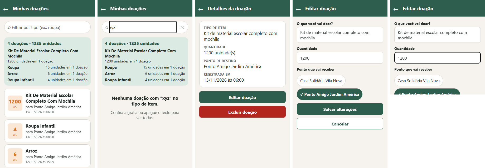
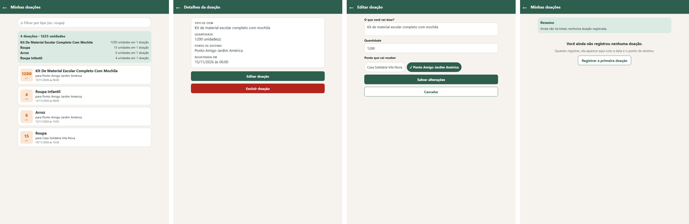

# Instituto Mão Amiga

Aplicativo do Instituto Mão Amiga, em Goiânia: mostra os pontos de coleta e distribuição de doações e guarda o histórico das doações registradas.

Autor: **LuuKeeTZ** — projeto individual da disciplina de Desenvolvimento de Aplicativos.

## Tecnologias

- React Native + Expo (SDK 58) com TypeScript
- React Navigation (native-stack)
- AsyncStorage (dados salvos no aparelho)

## Como rodar

```bash
npm install
npx expo start          # Expo Go no celular (QR code)
npx expo start --web    # no navegador
```

## Estrutura

```
App.tsx                 ponto de entrada (só monta a navegação)
src/
  navigation/           rotas e parâmetros de cada tela
  screens/              uma tela por arquivo
  components/           peças reaproveitadas (cartões, campos, botões, estados)
  storage/              acesso ao AsyncStorage (doacoesStorage.ts)
  utils/                validação, datas, totais e diálogos
  types/                tipos Ponto e Doacao
  theme/                cores, espaçamentos e tamanho mínimo de toque
docs/testes/            prints dos testes de layout
```

## Roteiro de demonstração da N1 (até 3 minutos)

1. **Registrar**: na tela inicial, "Registrar doação" → Roupa, 12, Casa Solidária Vila Nova → registrar. Repetir com Arroz (5) e Roupa de cama (3).
2. **Ver o histórico**: "Minhas doações" mostra as 3 doações (mais nova no topo) e o resumo "3 doações · 20 unidades" com os totais por tipo.
3. **Filtrar**: digitar "roupa" no campo de busca → aparecem só Roupa e Roupa de cama. Digitar "xyz" → mensagem citando o texto. Limpar → todas voltam.
4. **Editar**: tocar em Arroz → "Editar doação" → quantidade 8 → "Salvar alterações". O detalhe e o resumo mostram o valor novo.
5. **Excluir**: no detalhe, "Excluir doação" → confirmar. A doação some do histórico e do resumo.
6. **Fechar e reabrir o app**: o histórico continua lá (está no AsyncStorage).

## Decisões técnicas

- **Acesso ao armazenamento num arquivo só** (`src/storage/doacoesStorage.ts`, com `listarDoacoes`, `salvarDoacao`, `atualizarDoacao` e `excluirDoacao`): as telas não conhecem a chave nem o formato JSON. Se o lugar onde os dados ficam mudar, só esse arquivo muda.
- **Totais calculados, não salvos**: `calcularResumo` roda a cada renderização a partir do array de doações. Não existe um segundo dado para manter sincronizado, então o resumo nunca fica desatualizado depois de registrar, editar ou excluir.
- **Filtro sem segunda lista**: o único estado é o texto digitado; a lista exibida é calculada a partir dele e do array completo.
- **Um formulário para cadastrar e editar**: a mesma tela recebe (ou não) a doação nos parâmetros; as validações ficam em `validarDoacao` e valem para os dois casos.

## Testes de layout

Feitos no navegador (`npx expo start --web`) com Playwright, em **360x640** (celular pequeno) e **768x1024** (tablet). Um script mede todos os elementos tocáveis (mínimo 44x44), procura rolagem horizontal, elementos fora da tela e textos cortados, e simula o teclado aberto reduzindo a altura da janela para 360 px e focando cada campo.

| Tela | 360x640 | 768x1024 |
|---|---|---|
| Início, lista, detalhe do ponto, cadastro (Issue #06) |  |  |
| Histórico, filtro, detalhe e edição da doação (Issue #14) |  |  |
